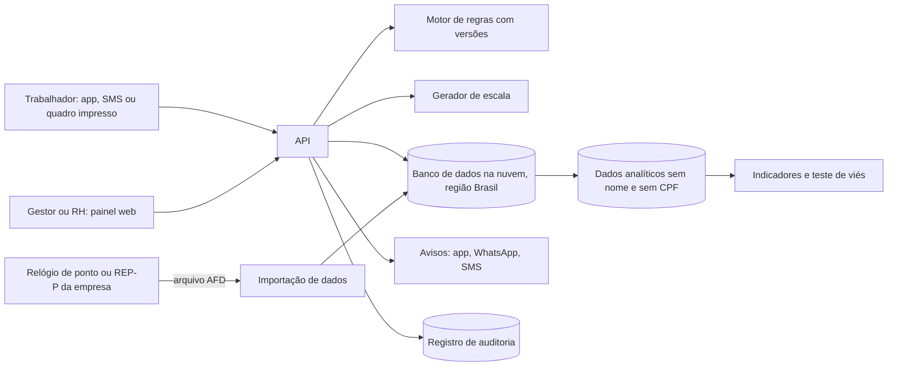

# FolgaCerta: escalas 5x2 e ponto transparente para pequenos e médios empregadores

> Entrega 2, Consultoria de TI, Turma 2N, 2026.2. Prof. Cid Andrade.

## 1. Abertura

| Integrante | GitHub | Área de carreira | RGM |
|---|---|---|---|
| Rúben Tavares Nascimento | [rb0710](https://github.com/rb0710) | DevSecOps | 47908246 |
| Tayrone Henrique do Carmo | [DrTayrone](https://github.com/DrTayrone) | Engenharia de Dados | 47873639 |
| Keveny Santos | [kevenxs7](https://github.com/kevenxs7) | Engenharia de Dados | 47878665 |

**Dossiê:** 1, Sistemas de ponto e escala após o fim da 6x1.

**Recorte:** empresas de comércio, alimentação e hospedagem, com 20 a 99 empregados, que abrem todos os dias da semana e precisam passar da escala 6x1 para a 5x2.

Por que esse recorte:
- São os setores em que a 6x1 é mais comum.
- A partir de 20 empregados o registro de jornada já é obrigatório (CLT, art. 74, §2º), então a empresa já tem ponto e só precisa reorganizar a escala.
- Nossa hipótese, que vamos testar no piloto, é que empresas desse tamanho raramente têm um RH só para montar escalas.

Ficam de fora as categorias com jornada especial (petróleo, aviação, caminhoneiros, saúde), porque o Senado prepara uma PEC separada para elas.

---

## 2. Análise do problema

### 2.1 Quem é afetado, onde e quanto

Em 16/10/2026 foi promulgada a Emenda Constitucional 141/2026, que acaba com a escala 6x1. A mudança vem em duas etapas (IEPREV, 2026):
- **16/12/2026:** a jornada máxima cai de 44 para 42 horas por semana e o trabalhador passa a ter dois dias de descanso.
- **Catorze meses depois da publicação:** a jornada chega a 40 horas por semana. Em ambas as etapas o salário não pode diminuir.

O Dieese, usando a PNAD de 2025, calcula que cerca de 26,8 milhões de trabalhadores são alcançados: 22 milhões com carteira assinada (54% dos empregados formais) e 4,8 milhões informais com jornada acima de 40 horas (Engeplus, 2026; Agência Brasil, 2026). O mesmo órgão aponta que 14,8 milhões de pessoas, ou 33,2% dos ocupados, trabalham em 6x1. A escala é mais frequente no transporte aéreo (53,2%), na hospedagem (52%), na alimentação (47,1%) e no comércio (42,2%) (CUT, 2026). Por isso o nosso recorte foca em comércio, alimentação e hospedagem.

Para o empregador, o problema é prático: o fim da 6x1 não obriga a fechar aos fins de semana, só exige revezar as equipes (IEPREV, 2026). Quem abre todos os dias precisa montar escalas novas, e é aí que a tecnologia entra.

### 2.2 Causas, com destaque para as tecnológicas

A causa de fundo é a mudança da lei. As causas tecnológicas, que a nossa proposta ataca, são:
- Os sistemas de ponto e escala foram feitos com a regra antiga (44 horas, 6x1) e o cliente não consegue trocar a regra sozinho.
- Em empresas pequenas, a escala é feita em planilha ou à mão, sem conferência automática de folgas, limite semanal e intervalos.
- Escala, ponto e folha de pagamento ficam separados, e o erro só aparece no fim do mês.
- O trabalhador quase nunca vê a escala com antecedência nem o saldo do banco de horas, e por isso tem dificuldade de contestar.
- A regra ainda vai mudar durante a transição (há uma PEC paralela no Senado e medidas para MEI e pequenas empresas por lei complementar). Um sistema com a regra "fixa" já nasce desatualizado.

Essas causas são avaliação do grupo, baseada na Portaria MTE 671/2021 e na cobertura da transição, e serão confirmadas nas conversas do piloto.

### 2.3 O que já existe e por que não basta

Já existem sistemas de ponto eletrônico por programa (REP-P, da Portaria 671/2021) e módulos de escala vendidos por empresas de folha e de ponto. Eles registram bem a jornada, mas nem sempre: (a) conferem sozinhos a regra nova, (b) mostram a escala ao trabalhador e deixam ele contestar, (c) cabem no preço e na rotina de uma empresa de 20 a 99 empregados. [PREENCHER: comparar 2 ou 3 produtos reais, dizendo o que cada um faz e não faz, com a data da consulta.]

---

## 3. Proposta tecnológica

### 3.1 Como funciona, passo a passo

**Para o gestor ou RH**
1. Cadastra a equipe, os turnos e as regras da empresa.
2. Informa quantas pessoas precisa em cada dia e horário.
3. O sistema propõe uma escala 5x2 que respeita a lei e mostra os conflitos, se houver.
4. O gestor revisa, ajusta e publica. Nenhuma escala chega ao trabalhador sem aprovação de uma pessoa.
5. No fim do mês, o sistema compara a escala prevista com o ponto real e aponta diferenças e horas extras.

**Para o trabalhador**
1. Recebe um aviso por app, WhatsApp ou SMS quando sai uma escala nova.
2. Vê seus dias de trabalho, seus dois dias de descanso e o saldo do banco de horas, no celular ou em quadro impresso na empresa.
3. Bate o ponto pelo meio que a empresa já usa e recebe o comprovante.
4. Se discordar de algo, abre uma contestação em poucos toques e acompanha a resposta.

### 3.2 Arquitetura

| Componente | O que faz | Onde fica | Quem acessa |
|---|---|---|---|
| App do trabalhador (PWA) | Mostra escala, saldo, comprovantes e contestação | Navegador do celular | O próprio trabalhador |
| Painel do gestor | Cadastro, demanda, revisão e publicação | Nuvem | Gestor e RH da empresa |
| Motor de regras | Guarda as regras de jornada, descanso e hora extra, cada uma com data de início | Nuvem | Equipe técnica altera, gestor consulta |
| Gerador de escala | Monta a escala respeitando limites legais e a distribuição justa de folgas | Nuvem, só quando chamado | Só a API |
| Banco de dados | Cadastro, escalas, ponto, contestações | Nuvem, região Brasil | Só a aplicação, por perfil de acesso |
| Importação de dados | Lê o arquivo do ponto, confere e carrega | Nuvem | Equipe de dados |
| Dados analíticos | Indicadores e teste de viés, sem identificar pessoas | Nuvem | Equipe de dados e gestão do projeto |
| Registro de auditoria | Guarda quem viu, mudou ou publicou o quê, sem poder apagar | Armazenamento protegido | Segurança e auditoria |

Cada empresa só enxerga os próprios dados, que ficam criptografados. Na primeira versão o sistema **não substitui o relógio de ponto**: ele se liga ao que a empresa já usa, pelo arquivo de dados previsto na Portaria 671/2021. Isso reduz custo e risco jurídico.

### 3.3 O trabalho de cada área e como se complementam

- **Engenharia de Dados:** modelo de dados de escala, ponto e banco de horas, importação do arquivo do ponto e checagem de erros (ponto duplicado, horário impossível).
- **Cloud:** infraestrutura na nuvem, região no Brasil, crescimento automático nos picos de fim de mês, backup e controle de custo.
- **DevSecOps e Cibersegurança:** entrega automática e segura do sistema, login com segundo fator, perfis de acesso, criptografia, registro de auditoria e plano para incidentes.
- **Ciência de Dados:** previsão simples de demanda, regras do gerador de escala, medida de justiça na distribuição de folgas e teste de viés.
- **Gestão:** conversa com empresas e trabalhadores, desenho do piloto, treinamento, indicadores, preço e quem sustenta o projeto.

**Quem do grupo cobre o quê:** Tayrone e Keveny (Engenharia de Dados) cuidam do modelo de dados, da importação do ponto e dos dados analíticos. Rúben (DevSecOps) cuida da nuvem, da entrega automática do sistema e da segurança. Ciência de Dados e Gestão não têm um integrante dedicado, então o grupo trata esses pontos em conjunto (previsão simples de demanda, regras de justiça da escala, piloto e indicadores) e deixa claro na arguição que são partes de apoio.

Uma área depende da outra: Cloud entrega a base onde Dados trabalha, Ciência de Dados usa os dados limpos de Engenharia, Segurança revisa tudo e Gestão diz o que é sucesso e confere com quem usa.

### 3.4 O que a tecnologia não resolve

- Não obriga o empregador a cumprir a lei. O sistema avisa quando há erro, mas a decisão e a fiscalização continuam com pessoas.
- Não resolve o custo da transição, a falta de gente em setores que funcionam todos os dias, nem a pressão por metas que gera hora extra.
- Não alcança os 4,8 milhões de informais citados pelo Dieese, porque eles não têm empregador formal para contratar o sistema.
- Não substitui acordo coletivo nem negociação com o sindicato.
- Não decide sozinho as categorias de jornada especial enquanto a regra delas não estiver fechada.

---

## 4. Análise ética

### 4.1 Matriz de riscos

| # | Risco | Probabilidade | Impacto | Classificação | Controle |
|---|---|---|---|---|---|
| R1 | Usar ponto e escala para vigiar ou punir (por exemplo, retaliar quem contesta) | Média | Alto | Alto | C2 e C6 |
| R2 | Escala injusta: fins de semana e turnos ruins caem sempre nos mesmos perfis (quem tem menos poder de barganha, quem tem filhos, os mais novos) | Média | Alto | Alto | C5 |
| R3 | Vazamento de dados de jornada e cadastro | Baixa | Alto | Alto | C4 |
| R4 | Excluir quem não tem smartphone, pacote de dados ou costume com tecnologia | Alta | Médio | Alto | C1 |
| R5 | Usar o sistema para esconder hora extra ou reduzir salário na transição | Média | Alto | Alto | C1 e C4 |
| R6 | Regra desatualizada gera escala fora da lei e prejudica o trabalhador | Média | Alto | Alto | C7 |
| R7 | Coletar mais dado do que precisa (biometria, localização) | Baixa | Alto | Médio | C3 |

### 4.2 Decisão

**Implantar com controles.** O sistema ajuda a cumprir uma regra constitucional recente e dá ao trabalhador uma visibilidade que hoje ele não tem. Mas ele lida com dados de jornada e poderia ser usado para pressionar ou excluir pessoas. Por isso só entra em produção depois dos controles C1 a C7, começando por um piloto pequeno e com revisão humana em toda escala. Não faremos biometria, localização contínua nem nota automática de "produtividade". Se o piloto mostrar viés que não some ou uso para retaliação, a ampliação fica suspensa até corrigir.

### 4.3 Controles antes de entrar em produção

| # | Controle | Eixo |
|---|---|---|
| C1 | O trabalhador vê escala e registros em linguagem simples, com a razão da escala, no app, por SMS e em papel. O comunicado público fica afixado na empresa | Transparência |
| C2 | Nenhuma escala é publicada sem aprovação de uma pessoa do RH, e qualquer mudança no ponto exige justificativa e aprovação | Revisão humana |
| C3 | Só se coleta nome, matrícula, cargo, escala e horários. Nada de biometria, localização ou dado de saúde. Dados analíticos sem identificar a pessoa | Minimização de dados |
| C4 | Criptografia, segundo fator para gestores, perfis de acesso, registro de auditoria que não pode ser apagado, teste de invasão antes do piloto e plano de resposta a incidentes | Segurança |
| C5 | A cada ciclo, medir se fins de semana, noites e folgas se distribuem de forma diferente entre grupos (idade, sexo, cargo, tempo de casa) e bloquear a publicação se a diferença passar do limite combinado | Teste de viés |
| C6 | Contestação no app, no RH ou no sindicato, com protocolo e resposta em até 5 dias úteis. Contestar não pode ser tratado como falta | Canal de contestação |
| C7 | Regras versionadas, com revisão jurídica a cada mudança na lei, na PEC paralela ou na lei complementar | Transparência e revisão humana |

### 4.4 LGPD

O empregador é o **controlador** e o FolgaCerta é o **operador** (Lei 13.709/2018, art. 5º, VI e VII).

| Dado | Finalidade | Base legal | Prazo |
|---|---|---|---|
| Nome, matrícula, cargo, contato | Identificar o trabalhador e enviar a escala | Execução de contrato (art. 7º, V) | Durante o vínculo e pelo prazo abaixo |
| Escala, horários de entrada e saída, banco de horas | Controlar a jornada e conferir as regras | Obrigação legal (art. 7º, II) | 5 anos, como a prescrição trabalhista (CF, art. 7º, XXIX), ou mais se houver processo [PREENCHER: confirmar com o jurídico] |
| Contestações e respostas | Garantir o direito de revisão | Exercício regular de direitos (art. 7º, VI) | 5 anos |
| Registros de acesso e alteração | Segurança e auditoria | Legítimo interesse (art. 7º, IX) | Pelo menos 6 meses (Marco Civil, art. 15) |

- **Dados sensíveis:** não tratamos nenhum. Biometria e saúde são sensíveis (art. 5º, II) e ficam fora. Se um atestado for necessário, ele fica com o RH, fora do sistema.
- **Menores:** pode haver aprendizes de 14 a 17 anos. Os dados deles seguem o melhor interesse do adolescente (art. 14) e só servem para a escala.
- **Decisão automatizada:** o trabalhador pode pedir revisão (art. 20), e a revisão humana obrigatória cobre isso.
- **Relatório de impacto (RIPD):** será feito antes do piloto (art. 38).
- **Direitos do titular (art. 18):** acesso, correção e eliminação, pelo encarregado de cada empresa.

### 4.5 Comunicado público (555 caracteres)

> Esta empresa passa a usar o FolgaCerta para montar escalas 5x2 e registrar ponto, em cumprimento à Emenda Constitucional 141/2026. O sistema usa nome, matrícula, escala e horários de entrada e saída, sem biometria e sem localização. Uma pessoa do RH revisa cada escala antes de publicar, e você a consulta no celular ou por SMS. Se discordar de uma escala ou de um registro, conteste pelo app, pelo RH ou pelo sindicato, com resposta em até 5 dias úteis. Os dados ficam guardados por 5 anos, como exige a lei trabalhista. Dúvidas: [e-mail do encarregado].

Contagem: 555 caracteres, com espaços e com o marcador do e-mail.

---

## 5. Acessibilidade e inclusão digital

### 5.1 Quem pode ficar de fora e o que fazemos por cada grupo

| Grupo | Barreira | O que a proposta faz |
|---|---|---|
| Sem smartphone ou com pouco pacote de dados | Não abre o app | Escala por SMS, quadro impresso e totem na empresa. O app é leve e roda em celular simples |
| Pouca familiaridade digital ou leitura limitada | Tela complicada, texto longo | Linguagem simples, ícones com texto, poucos passos e treino presencial de 15 minutos no piloto |
| Cegos ou com baixa visão | Tela sem rótulo, contraste baixo | Compatível com leitor de tela, bom contraste, texto ampliável e escala em formato de texto |
| Surdos ou com deficiência auditiva | Aviso só por voz | Avisos sempre por escrito, contestação por escrito |
| Deficiência motora | Botão pequeno, gesto difícil | Botões grandes, uso por teclado, sem gestos obrigatórios |
| TDAH, dislexia e outras diferenças cognitivas | Informação demais, prazo curto | Tela limpa, uma tarefa por vez, lembretes ajustáveis |
| Migrantes e quem fala outro idioma | Só português | Textos simples, prontos para tradução, e desenhos de apoio |
| Quem divide o celular com a família | Sem privacidade ou acesso contínuo | Acesso por SMS e papel, sem exigir app instalado |

### 5.2 Requisitos

Baseados na WCAG 2.2, nível AA, e na aula de Inclusão Digital e Acessibilidade:
- Contraste de pelo menos 4,5 para 1 no texto (1.4.3) e nunca usar só a cor para passar informação (1.4.1).
- Texto que pode ser ampliado a 200% sem perder conteúdo (1.4.4).
- Tudo usável pelo teclado (2.1.1) e botões de pelo menos 24 por 24 pixels (2.5.8).
- Nome e função de cada elemento disponíveis para leitor de tela (4.1.2).
- Mensagens de erro claras, que dizem como corrigir (3.3.1), e login que não exige tarefa difícil de memória (3.3.8).
- Seguir o eMAG e a Lei Brasileira de Inclusão (Lei 13.146/2015, art. 63).
- Testar com pessoas reais, inclusive com leitor de tela, antes do piloto.

---

## 6. Sustentabilidade

### 6.1 Impacto ambiental, com base na aula de TI Verde

- **Menos equipamento:** o ponto pode ser por programa e o app roda no celular que a pessoa já tem, então não é preciso comprar relógios novos nem trocar aparelhos.
- **Nuvem só quando precisa:** o gerador de escala roda poucas vezes por mês por empresa, e a infraestrutura diminui fora dos picos de fim de mês.
- **Provedor:** preferir região no Brasil de um provedor que publique metas e relatórios de energia renovável. [PREENCHER: citar o relatório do provedor escolhido, com data.]
- **Menos papel:** escalas e comprovantes digitais. O papel fica só como opção de inclusão.
- **Menos dados guardados:** guardar só o necessário e pelo prazo da lei diminui armazenamento e risco.
- **Medição:** no piloto, estimar a pegada de carbono mensal com a ferramenta do provedor e divulgar. [PREENCHER: valor medido.]

### 6.2 Quem mantém e quem paga depois do primeiro ano

- **Quem paga:** o empregador, com assinatura mensal por empregado ativo. O valor será definido no piloto, a partir do custo real de nuvem e suporte, e deve ser menor que o de soluções completas de folha e ponto para esse porte. [PREENCHER: faixa de preço depois do piloto.]
- **Quem mantém:** a equipe do projeto, com duas rotinas fixas: atualizar o motor de regras quando a lei ou os acordos mudarem e aplicar correções de segurança.
- **Custos que continuam:** revisão jurídica das regras, nuvem e suporte. A assinatura precisa cobrir esses três depois do primeiro ano.
- **Sem prender o cliente:** ele pode exportar escalas e registros em formato aberto quando quiser.

---

## 7. Impacto esperado

### 7.1 Indicadores e metas

As metas são do projeto. Os pontos de partida serão medidos nas empresas do piloto antes da implantação.

| Indicador | Como medir | Meta |
|---|---|---|
| Escalas sem violação de regra (dois dias de descanso, limite semanal, intervalo) | Conferência automática do motor de regras | 100% |
| Antecedência da publicação da escala | Data da publicação menos data do primeiro dia da escala | 14 dias ou mais em 90% das escalas |
| Tempo do gestor para montar a escala do mês | Medir antes e depois, no piloto | Redução de 50% ou mais |
| Trabalhadores que consultam a escala sem ajuda | Registro de acesso e pesquisa curta | 85% ou mais no primeiro mês |
| Contestações respondidas em até 5 dias úteis | Protocolo no sistema | 90% ou mais |
| Horas extras por trabalhador | Folha e ponto | Redução de 20% em 6 meses |
| Diferença na distribuição de fins de semana entre grupos | Medida do teste de viés | Dentro do limite combinado em 100% dos ciclos |
| Satisfação do trabalhador com a escala | Pesquisa de 3 perguntas por trimestre | Nota média 4 de 5 ou mais |

### 7.2 Como ouvir os usuários antes de ampliar

- Piloto de 90 dias em 3 empresas de tipos diferentes (comércio, alimentação, hospedagem).
- Conversas com gestores e rodas de conversa com trabalhadores no começo, no meio e no fim, com convite a um representante do sindicato.
- Pesquisa curta no app e por SMS, com resposta anônima.
- Só ampliamos se as metas de contestação, de uso sem ajuda e de escalas sem violação forem cumpridas e o teste de viés estiver dentro do limite.

### 7.3 O que fazer se a solução não pegar

- Se menos de 50% dos trabalhadores consultarem a escala em 60 dias, descobrir a barreira (acesso, linguagem ou confiança) e reforçar SMS e papel antes de mexer no produto.
- Se os gestores não adotarem, simplificar a entrada de demanda e reduzir o produto ao verificador de regras, que é o que mais pesa no início da transição.
- Se mesmo assim não houver adoção, abrir o motor de regras como biblioteca livre, devolver os dados dos clientes em formato aberto, eliminar o resto conforme a LGPD e encerrar o serviço com aviso prévio.

---

## 8. Quadro de decisões

| # | Decisão | Alternativas | Por que esta |
|---|---|---|---|
| 1 | Nuvem pública, região Brasil | Servidor próprio do cliente; nuvem fora do país | Empresa pequena não tem equipe para manter servidor. Região no Brasil facilita a LGPD |
| 2 | App web (PWA) com SMS e papel como alternativa | App nativo; só SMS; só site | O PWA não exige loja de aplicativos nem celular novo, e SMS e papel cobrem quem está sem internet |
| 3 | Integrar ao relógio de ponto que a empresa já usa | Criar um REP-P próprio | O REP-P tem exigências técnicas e jurídicas pesadas para um grupo de três pessoas. Integrar entrega valor mais rápido |
| 4 | Gerador de escala por regras e restrições, com revisão humana | Planilha com fórmulas; aprendizado de máquina; sorteio | As regras da lei são explícitas e podem ser auditadas, o que o aprendizado de máquina não garante. A planilha não cresce para várias lojas |
| 5 | Sem biometria nem localização na versão inicial | Biometria facial ou digital; localização no app | São dados sensíveis e vigilância além do necessário. O ponto continua no relógio da empresa |
| 6 | Motor de regras com versões, editável sem refazer o sistema | Regras fixas no código | A lei ainda vai mudar na transição |
| 7 | Assinatura por empregado ativo | Licença única; gratuito com anúncios | Dá receita previsível para manter as regras atualizadas. Anúncio é incompatível com dado de jornada |

---

## 9. Capítulos individuais

> O papel de cada um precisa bater com os commits e pull requests do repositório. Confiram o histórico antes de entregar.

### 9.1 Rúben Tavares Nascimento (DevSecOps)

**Papel no projeto:** fui o integrante de Back-End e DevSecOps e fiquei com a pesquisa jurídica, de segurança e de infraestrutura. Pesquisei o texto e o calendário da Emenda Constitucional 141/2026 (as duas etapas, o que muda para terceirizados e pequenas empresas e a PEC paralela do Senado), li a Portaria MTE 671/2021 para entender o registro eletrônico de ponto e a LGPD para montar a tabela de dados, bases legais e prazos. Com essa pesquisa, escrevi a análise ética (seção 4), a arquitetura e a parte de segurança da proposta (seção 3.2) e o quadro de decisões sobre nuvem, app e ponto (seção 8). Também revisei o documento inteiro para que todos pudessem explicá-lo na arguição.

**Plano de desenvolvimento (6 a 12 meses):**
- Competências que faltam: [PREENCHER: duas ou três, reais].
- Meta SMART 1: [PREENCHER. Formato: o que, quanto, até quando. Exemplo para editar: "Concluir um curso de CI/CD e publicar um pipeline funcionando no GitHub até 30/04/2027"].
- Meta SMART 2: [PREENCHER].

**Feedback dos colegas (escrito em conjunto):** [PREENCHER: o que Tayrone e Keveny dizem do Rúben, com um ponto forte e um a melhorar].

### 9.2 Tayrone Henrique do Carmo (Engenharia de Dados)

**Papel no projeto:** fui integrante de Engenharia de Dados e fiquei com a busca de dados e fontes do problema. Pesquisei o levantamento do Dieese com a PNAD 2025 (26,8 milhões de trabalhadores alcançados, 14,8 milhões em 6x1 e os setores mais afetados), confrontei os números em mais de uma notícia e separei só fontes recentes. Com isso escrevi a análise do problema (seção 2.1 e 2.2) e os indicadores e metas de impacto esperado (seção 7). Também desenhei o modelo de dados e o fluxo de importação do ponto descritos na seção 3. Participei da revisão final do documento inteiro.

**Plano de desenvolvimento (6 a 12 meses):**
- Competências que faltam: SQL avançado para validação de regras, testes automatizados para o motor de regras e comunicação técnica — explicar o dado de forma simples para quem não é da área, como o dono da loja.
- Meta SMART 1: Até março de 2027, concluir 1 curso de SQL + Python para regras de negócio e aplicar em 2 projetos pessoais com testes automatizados, publicando os repositórios no GitHub.
- Meta SMART 2: Até junho de 2027, apresentar 1 projeto de dados em público (na faculdade ou em meetup), com documentação clara do modelo de dados e dos KPIs, para melhorar a comunicação e o portfólio.

**Feedback dos colegas (escrito em conjunto):** [PREENCHER].

### 9.3 Keveny Santos (Engenharia de Dados)

**Papel no projeto:** fui integrante de Engenharia de Dados e fiquei com a pesquisa de soluções existentes, acessibilidade e sustentabilidade. Pesquisei sistemas comerciais de ponto e de escala para comparar o que já existe e por que não basta (seção 2.3), estudei a WCAG 2.2, o eMAG e a Lei Brasileira de Inclusão para definir quem pode ficar de fora e os requisitos (seção 5) e levantei as práticas de TI Verde e os custos de manter o sistema depois do primeiro ano (seção 6). Também organizei as referências (seção 10) e participei da revisão final do documento inteiro.

**Feedback dos colegas (escrito em conjunto):** A participação do Keveny foi necessária para estruturar o projeto. Ele focou na modelagem e no dicionário de dados, organizando a lógica do sistema para as novas escalas de trabalho.

---

## 10. Referências

**Dados e notícias dos últimos dois anos**
- AGÊNCIA BRASIL. *Fim da 6x1: saiba quando entra em vigor nova jornada de trabalho.* Out. 2026. https://agenciabrasil.ebc.com.br/politica/noticia/2026-10/fim-da-6x1-saiba-quando-entra-em-vigor-nova-jornada-de-trabalho
- ENGEPLUS. *Fim da escala 6x1 poderá impactar 26,8 milhões de trabalhadores; advogada explica mudanças para empresas.* 2026 (cita o Dieese, com PNAD 2025). https://engeplus.com.br/noticia/fim-da-escala-6x1-podera-impactar-26-8-milhoes-de-trabalhadores-advogada-explica-236116
- CUT. *Saiba quais setores são mais afetados pela escala 6x1.* 2026 (cita o Dieese). https://www.cut.org.br/noticias/fim-da-escala-6x1-aguarda-votacao-no-senado-saiba-os-setores-que-ais-sofrem-com-95c8/
- IEPREV. *Fim da escala 6x1: o que foi aprovado, quando começa a valer e o que muda na prática.* 16 out. 2026. https://www.ieprev.com.br/blog/fim-da-escala-6x1-o-que-foi-aprovado-quando-comeca-a-valer-e-o-que-muda-na-pratica
- EXAME. *Fim da escala 6x1: Senado prepara PEC para deixar categorias fora das regras.* Out. 2026. https://exame.com/brasil/fim-da-escala-6x1-senado-prepara-pec-para-deixar-categorias-fora-das-regras/
- JORNAL PEQUENO. *Fim da escala 6×1 terá nova PEC para jornadas especiais.* 3 nov. 2026. https://jornalpequeno.com.br/2026/11/03/fim-da-escala-6x1-tera-nova-pec-para-jornadas-especiais/

**Normas e padrões (base legal, por isso fora do limite de dois anos)**
- BRASIL. Emenda Constitucional nº 141, de 2026. [PREENCHER: conferir o texto oficial no site do Planalto.]
- BRASIL. Constituição Federal, art. 7º.
- BRASIL. Consolidação das Leis do Trabalho, art. 74.
- BRASIL. Ministério do Trabalho e Emprego. Portaria MTE nº 671, de 2021.
- BRASIL. Lei nº 13.709, de 2018 (LGPD).
- BRASIL. Lei nº 12.965, de 2014 (Marco Civil da Internet), art. 15.
- BRASIL. Lei nº 13.146, de 2015 (Lei Brasileira de Inclusão), art. 63.
- W3C. *Web Content Accessibility Guidelines (WCAG) 2.2.* 2023. https://www.w3.org/TR/WCAG22/
- BRASIL. *eMAG, Modelo de Acessibilidade em Governo Eletrônico.*

**A completar pelo grupo**
- [PREENCHER: material das aulas de 05/10 (análise ética), de Inclusão Digital e Acessibilidade e de TI Verde, com o nome exato dos slides.]
- [PREENCHER: relatório de sustentabilidade do provedor de nuvem escolhido, com data.]
- [PREENCHER: páginas dos 2 ou 3 produtos comparados na seção 2.3.]
